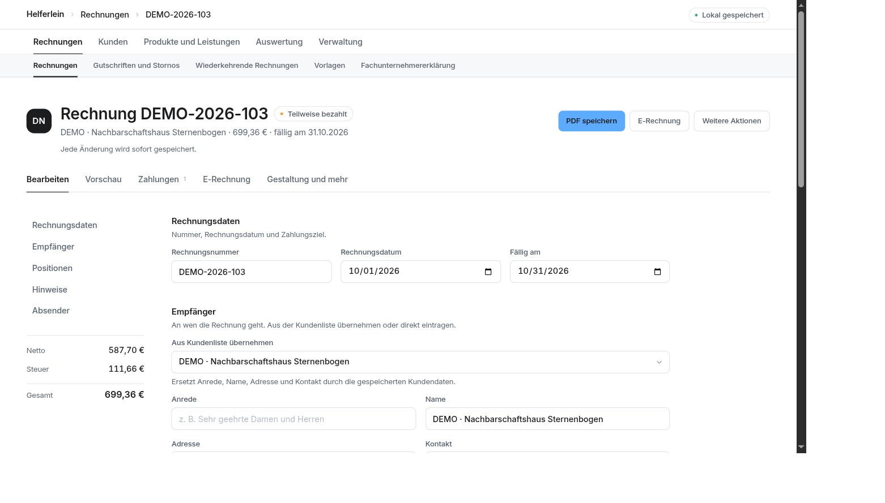
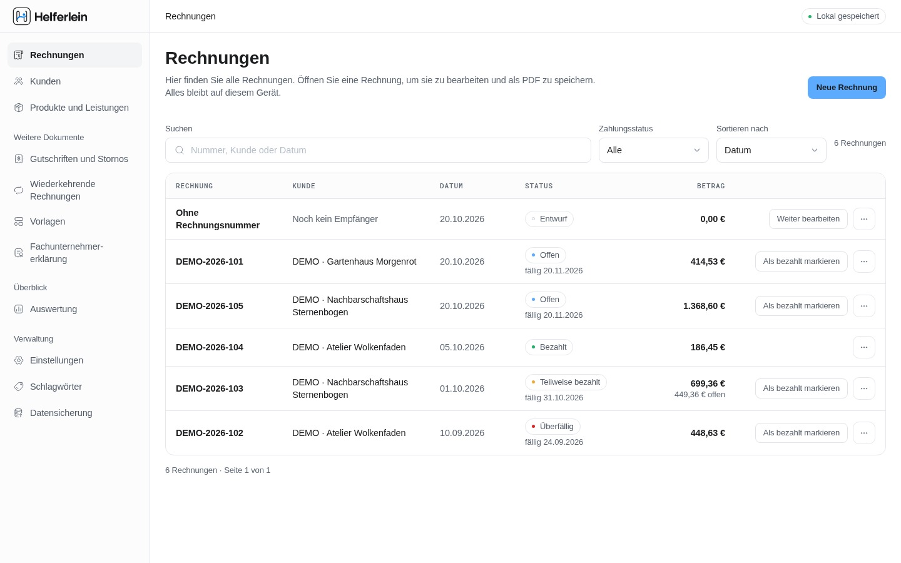
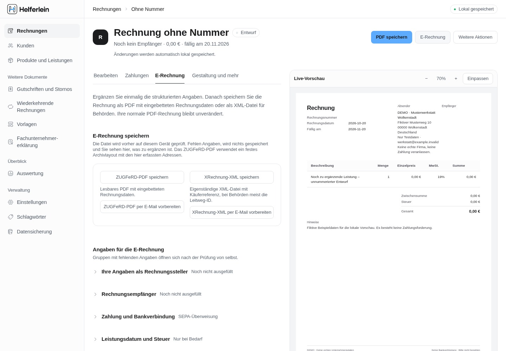
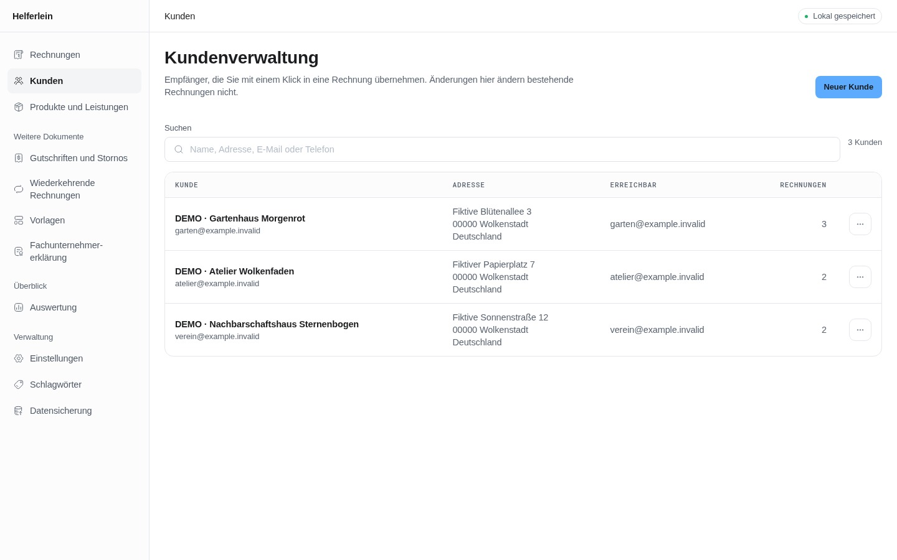

<p align="center">
  
</p>

<p align="center">
  <a href="https://github.com/LordOfMim/invoice-app/releases/latest"></a>
  <a href="https://github.com/LordOfMim/invoice-app/actions/workflows/build.yml"></a>
  <a href="LICENSE"></a>
</p>

# Helferlein

Lokale Rechnungsverwaltung für macOS, Windows und Linux – mit Kunden, Produkten, Vorlagen, Zahlungen, Gutschriften, wiederkehrenden Rechnungen und JSON-Sicherungen. Alle Daten bleiben auf dem eigenen Gerät; die installierte App und ihre E-Rechnungsexporte funktionieren vollständig offline.



## Funktionen

- **Rechnungen mit Live-Vorschau** in drei Vorlagen (Classic, Modern, Minimal), eigenem Logo und direktem PDF-Export
- **E-Rechnung**: ZUGFeRD-PDF/A-3b und XRechnung (CII), jeweils erst nach bestandener lokaler Prüfung speicherbar
- **Kunden, Produkte und Leistungen**, Schlagwörter und wiederverwendbare Vorlagenvarianten
- **Zahlungen, Teilzahlungen, Gutschriften und Stornos** mit Auswertung offener und überfälliger Beträge
- **Wiederkehrende Rechnungen** sowie eine druckbare Fachunternehmererklärung
- **Datensicherung** als JSON-Export und -Import, automatische Sicherung vor jedem Versionswechsel
- Oberfläche auf Deutsch und Englisch, keine Cloud, kein Konto, keine Telemetrie

| Rechnungsliste | E-Rechnung | Kunden |
| --- | --- | --- |
|  |  |  |

## Download und Installation

Fertige Pakete stehen unter [**Releases**](https://github.com/LordOfMim/invoice-app/releases/latest). Java oder Node.js müssen nicht installiert sein.

| System | Datei |
| --- | --- |
| macOS (Apple Silicon) | `Helferlein-<Version>-mac-arm64.dmg` |
| macOS (Intel) | `Helferlein-<Version>-mac-x64.dmg` |
| Windows 10/11 (64 Bit) | `Helferlein-<Version>-win-x64.exe` (Installer) oder `…-win-x64-portable.exe` |
| Linux (64 Bit) | `Helferlein-<Version>-linux-x86_64.AppImage` oder `…-linux-amd64.deb` |

Die Pakete sind derzeit **nicht signiert**. macOS verlangt deshalb beim ersten Start die Freigabe unter *Systemeinstellungen → Datenschutz & Sicherheit → „Dennoch öffnen“*; Windows SmartScreen zeigt „Weitere Informationen → Trotzdem ausführen“.

Vor einem Update einer bestehenden Installation bitte in der alten Version unter **Datensicherung** eine JSON-Sicherung exportieren (siehe [Bestandsdaten und Upgrade](#bestandsdaten-und-upgrade)). Änderungen je Version stehen im [Änderungsprotokoll](CHANGELOG.md).

## Entwickeln und prüfen

Node.js ab 22.12 verwenden. Abhängigkeiten sind exakt gepinnt.

```sh
npm ci
npm run dev
```

Die Webansicht öffnet die Rechnungsliste unter `http://localhost:3000`. Für die Desktop-App `npm run electron:dev` verwenden. Die geprüften E-Rechnungsexporte benötigen die einmalige Vorbereitung mit `npm run einvoice:prepare`; gewöhnlicher Druck/PDF bleibt davon unabhängig.

```sh
npm run einvoice:prepare
npm run check
npm run build:app
```

`EINVOICE_REQUIRE_INTEGRATION=1` verhindert, dass ein fehlender lokaler Validator in Release-Prüfungen als übersprungener Test durchgeht. Die CI verwendet diese Einstellung und prüft XML sowie echte mehrseitige PDF/A-Dateien.

## Desktop-Pakete

```sh
npm run electron:build:mac -- --arm64 --publish never
npm run electron:build:mac -- --x64 --publish never
npm run electron:build:win -- --x64 --publish never
npm run electron:build:linux -- --x64 --publish never
```

Intel und Apple Silicon werden getrennt gebaut. Der Build lädt die passende Java-Laufzeit, den Rechnungsvalidator und eingebettete Schriftdateien aus gepinnten offiziellen Quellen, prüft ihre SHA256-Prüfsummen und packt sie mit ein. Auf dem Rechner des Nutzers ist keine Java- oder Node-Installation nötig. Die Quellen unter `electron/einvoice-runtime` und `electron/einvoice-assets` sind generierte, ignorierte Buildressourcen.

Die macOS-Mindestversion bleibt mit Electron 43 bei macOS 12. Ein neuer Electron-Hauptversionssprung muss gegen die tatsächlich eingesetzte macOS-Version geprüft werden. Abhängigkeiten und E-Rechnungsregeln brauchen regelmäßige Wartung; eine unbegrenzt unveränderte Installation kann nicht für zukünftige Betriebssysteme zugesichert werden.

Die CI erzeugt getrennte Mac-DMGs, Windows-Installer und Linux-Pakete als Prüfartefakte. Ein Build ohne Zertifikat ist nicht signiert oder notarisiert.

### Veröffentlichen

1. `version` in `package.json` erhöhen (`npm version <x.y.z> --no-git-tag-version`) und `CHANGELOG.md` ergänzen.
2. Nach dem Merge auf `main` den passenden Tag in Kleinbuchstaben pushen: `git tag v<x.y.z> && git push origin v<x.y.z>`. Die CI bricht ab, wenn Tag und Paketversion nicht übereinstimmen.
3. Die CI legt den Release mit allen Paketen als **Entwurf** an. Nach Prüfung der Dateien wird er unter Releases veröffentlicht.

Für die Installation auf einem produktiv genutzten Mac bleiben Signierung/Notarisierung, ein Gatekeeper-Test und ein Upgrade-Test mit einer Kopie des echten Datenordners empfohlen.

## Bestandsdaten und Upgrade

Anwendungs-ID, Produktname „Helferlein“, Speicherschlüssel und bisherige Verschlüsselung bleiben erhalten. Daten liegen auf macOS weiterhin unter `~/Library/Application Support/Helferlein`, unter Windows und Linux im Benutzerdatenordner der App (`%APPDATA%` bzw. `~/.config`). Das neue optionale E-Rechnungsmodell erfordert keine Umwandlung alter Rechnungen. Beim ersten Start einer neuen Version sichert Helferlein die vorhandene verschlüsselte Datei zusätzlich unverändert. Vor dem Installationswechsel trotzdem den vollständigen Datenordner kopieren und eine JSON-Sicherung aus der alten App exportieren.

Eine vorhandene gültige Desktop-Sicherung ist immer maßgeblich, auch wenn sie bewusst leer ist. Ungültige Daten werden nicht durch einen leeren Bestand ersetzt. Vor einem JSON-Import wird der bisherige Stand zusätzlich gesichert. Bei nicht lesbaren Daten bietet die Oberfläche Originalexport und Wiederherstellung an. Alte browserbasierte Daten eines anderen historischen localhost-Ports müssen aus der alten App als JSON exportiert werden.

- [Upgrade- und Mac-Prüfung](docs/macOS-upgrade.md)
- [E-Rechnungen, unterstützte Fälle und technische Prüfung](docs/einvoice.md)
- [Umsetzung, Prüfstand und Freigabe](docs/modernization.md)
- [Bisherige Produktanforderungen](REQUIREMENTS.md)

## Mitwirken und Lizenz

Fehler und Wünsche bitte als [Issue](https://github.com/LordOfMim/invoice-app/issues) melden. Der Quelltext steht unter der [MIT-Lizenz](LICENSE); die gebündelten Schriften Inter und Roboto Mono unter der SIL Open Font License (`public/licenses`).
